  

  <b>Java Backend Engineer</b> &nbsp;·&nbsp; Spring Boot &nbsp;·&nbsp; AWS &nbsp;·&nbsp; Distributed Systems &nbsp;·&nbsp; Agentic AI

  <picture>
    <source media="(prefers-color-scheme: dark)" srcset="https://readme-typing-svg.demolab.com?font=JetBrains+Mono&weight=500&size=17&duration=3000&pause=900&color=DAA520&center=true&vCenter=true&width=480&height=44&lines=Charged+twice%3F+Not+on+my+watch.;15s+to+2s+with+one+Redis+cache;Bulk+reports%3A+8+hrs+to+2+hrs;The+LLM+talks.+The+rules+decide.">
    
  </picture>

  
  
  
  

  

  <a href="#impact"> <b>Impact</b></a> &nbsp;·&nbsp;
  <a href="#experience"> <b>Experience</b></a> &nbsp;·&nbsp;
  <a href="#projects"> <b>Projects</b></a> &nbsp;·&nbsp;
  <a href="#ai"> <b>AI Work</b></a> &nbsp;·&nbsp;
  <a href="#stack"> <b>Stack</b></a>

---

<h2> About</h2>

Java backend engineer with 2+ years across healthcare and payments, based in Bengaluru. I build APIs that stay correct under retries and failures, rules engines that run fast, and agentic AI that is grounded in data. In my systems **the LLM understands the question, and deterministic rules make the decision.**

- **Backend:** API design, service-layer architecture, transactions, idempotency, concurrency, testing
- **Cloud & delivery:** AWS, Docker, GitHub Actions, CI/CD with OIDC
- **AI systems:** RAG, tool orchestration, session memory, MCP, deterministic lookups

**Looking for:** Backend Engineer and Agentic AI Engineer roles. I will treat your production database with the respect of a very nervous person.

---

<h2> Impact</h2>

*Results from my work at Endava, shared at the level I'm permitted to.*

| Result | How |
|:--|:--|
| **15s → 2s** repeat plan evaluation | Redis cache keyed by plan ID and configuration, so identical requests skip recalculation |
| **~8 hrs → ~2 hrs** 10,000+ reports | Batch processing instead of one-at-a-time generation, plus PDF → PDF + Excel with multi-attachment email delivery |
| **15 → 6 min** deployments, 88% JUnit coverage | Per-Lambda GitHub Actions pipelines using OIDC (no stored AWS keys) that redeploy only the Lambdas that changed |
| **Silent failures → FAILED** SQS pipeline | Plans that exhausted their retries used to vanish with no status. Dead-letter-queue handling now marks them FAILED, so every request ends visibly |
| **50,000-plan catalog** 5-6k daily users | Client-specific plan configuration features on a healthcare plan platform |

---

<h2> Experience</h2>

### Endava · Software Developer
*Sep 2025 – Present · Benefit Calculation Rules Platform*

- Replaced an Excel-based benefit-rules tool (the spreadsheet did not put up a fight) with a serverless REST rules engine, built with a team of 7, evaluating 8-10 scenarios per plan
- Built the API Gateway + Lambda layer for evaluating configured plan scenarios
- Built 5+ GenAI and agentic AI proofs of concept alongside the backend work (see [AI Work](#ai))

<picture>
  <source media="(prefers-color-scheme: dark)" srcset="https://skillicons.dev/icons?i=java,spring,aws,dynamodb,redis,githubactions&theme=dark">
  
</picture>

### Endava · Associate Software Engineer
*Aug 2024 – Sep 2025 · Healthcare Plan Management Platform*

- Built the Kafka consumer in the rule service that applies business rules to every plan event and validates it against configured constraints
- Built client-specific plan configuration features and cut bulk report generation from ~8 hrs to ~2 hrs

<picture>
  <source media="(prefers-color-scheme: dark)" srcset="https://skillicons.dev/icons?i=java,spring,kafka,redis&theme=dark">
  
</picture>

---

<h2> Projects</h2>

###  [Idempotent Payment Gateway](https://github.com/mathalapavankalyan/payment-gateway)
*"Charged twice? Not on my watch."*

- **Problem:** users double-tap Pay, networks drop, clients retry, and the customer should still be charged exactly once
- **Approach:** an `Idempotency-Key` plus a payload hash rejects key reuse with a different body (a ₹500 key can't sneak in a ₹5000 payment), and a database unique constraint settles races
- **Correctness:** order and payment state machines inside `@Transactional` boundaries; tests for duplicates, key reuse, concurrency, and rollback
- **Delivery:** GitHub Actions builds the Docker image and pushes it to Amazon ECR through OIDC

<picture>
  <source media="(prefers-color-scheme: dark)" srcset="https://skillicons.dev/icons?i=java,spring,mysql,docker,githubactions,aws&theme=dark">
  
</picture>

###  [Payment-Resolution Assistant](https://github.com/mathalapavankalyan/paytm-resolve)
*"The LLM talks. The rules decide."*

- **Problem:** "payment failed but money was deducted" needs an investigation, not a generic chatbot reply
- **Approach:** a LangGraph agent handles intent understanding, tool selection, and session memory, while deterministic search handles payment lookups, so money-critical answers are never left to the LLM
- **Experience:** investigation progress streams to a React UI over Server-Sent Events, so users watch the steps instead of a spinner
- **Result:** Top 20 of ~4,774 in the Paytm Build for India AI Hackathon (team of 2)

<picture>
  <source media="(prefers-color-scheme: dark)" srcset="https://skillicons.dev/icons?i=python,fastapi,react&theme=dark">
  
</picture>

<b>More: Load Balancer</b>

[**Load Balancer**](https://github.com/mathalapavankalyan/load-balancer): *3 servers, 1 Nginx, 0 drama.* Three Spring Boot instances behind Nginx round-robin routing, sharing one MySQL 8 database, started with a single `docker compose up`.

---

<h2> GenAI &amp; Agentic AI</h2>

### Plan Recommendation Assistant: RAG, Knowledge Graph &amp; MCP
*"The LLM gets a tool menu, not the keys to the database."*

- RAG pipeline over ~100 policy and rule documents (OpenAI Embeddings, Chroma, top-k retrieval), validated against plan data
- Weighted knowledge graph in MongoDB: age, monthly premium, and plan type score each policy and steer the agent to the right documents
- FastAPI tools (DB fetch, RAG, summarize) exposed through MCP, so the agent works through defined tool contracts and never touches the underlying data sources
- Demoed to leadership and a client

###  AI-Native Workforce Management System
**Winner, APAC: OpenAI × Endava Codex Hackathon (55+ teams).** Designed the multi-agent workflow that recommends available candidates for an opportunity based on its details. Built with Codex, React, Python, and FastAPI.

---

<h2> Technical Skills</h2>

  <picture>
    <source media="(prefers-color-scheme: dark)" srcset="https://skillicons.dev/icons?i=java,spring,python,fastapi,mysql,mongodb,redis,kafka,aws,docker,githubactions,git&theme=dark&perline=6">
    
  </picture>

| Area | Technologies |
|:--|:--|
| **Languages** | Java 17, Python, SQL |
| **Backend** | Spring Boot, REST APIs, Hibernate/JPA, FastAPI, JUnit, Mockito |
| **AI & Agentic** | LangChain, LangGraph, RAG, OpenAI Embeddings, Chroma, knowledge graphs, MCP, tool calling |
| **Data & Messaging** | MySQL, Microsoft SQL Server, MongoDB, DynamoDB, Redis, Kafka, Amazon SQS |
| **Cloud & DevOps** | AWS (Lambda, API Gateway, S3, DynamoDB, ECR), Docker, Git, GitHub Actions, OIDC |

 <b>Achievements &amp; education</b>

- Winner, APAC: OpenAI × Endava Codex Hackathon (55+ teams)
- Top 20 of ~4,774: Paytm Build for India AI Hackathon
- Two-time Inter-College CodeHack winner (the second one wasn't a fluke)
- Top scorer, NPTEL Joy of Computing
- B.Tech, Computer Science, NRI Institute of Technology · CGPA 8.6/10 · 2020 – 2024

---

  <i>I build backend systems that behave predictably under retries, failures, and real-world conditions.</i> 
  <i>Star a repo and I'll say thanks exactly once, no matter how many times you click. It's idempotent.</i>

