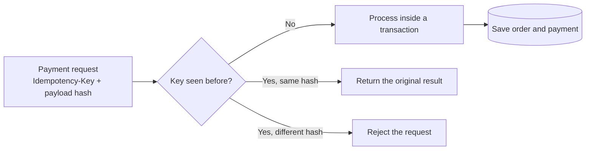
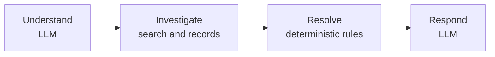

  

  

  
  
  
  

---

## 👋 About

I'm a **software engineer with 2+ years of experience**, working in **Java/Spring Boot and Python/FastAPI** on healthcare insurance platforms, and building payment systems in my own projects. I started in backend engineering, then moved into **agentic AI and RAG** in Sep 2025. I build the parts that make a product trustworthy: APIs, queues, caches and pipelines that stay correct under retries, concurrency and failure.

> **My rule for AI in production:** the LLM understands the question, and deterministic rules make the decision.

I would rather ship a system that behaves predictably under real traffic than one that only looks good in a demo.

**Open to:** Backend Engineering and AI Engineering roles at product companies and startups.

---

## ⭐ Highlights

| | |
|:--|:--|
| 🥇 **Winner, APAC** | OpenAI × Endava Codex Hackathon, 55+ teams, with LangGraph and LangChain multi-agent workflows |
| 🏅 **Top 20 of ~4,774** | Paytm Build for India AI Hackathon (team of 2) |
| ⚡ **15s → 2s** | API response time, by caching repeat plan evaluations in a shared Redis layer |
| 📦 **~8 hrs → ~2 hrs** | Batch processing for 10,000+ report generation |

---

## 💼 What I build at work

- **Cost-calculation platform for health plans:** 15+ APIs in Java/Spring Boot and Python/FastAPI on AWS Lambda and DynamoDB, with SQS and a DLQ to absorb traffic spikes.
- **Event-driven microservices:** Kafka-based bulk plan creation and updates, with scheduled PDF and Excel exports.
- **Agentic AI for claims and policies:** LangGraph agents that check claim status, handle resubmissions and recommend policies, with PHI kept out of prompts and logs.
- **RAG over ~100 policy documents** using OpenAI embeddings and Chroma, steered by a weighted knowledge graph in MongoDB.
- **MCP tool servers on FastAPI**, so the LLM sees tool interfaces and never the underlying data sources.
- **CI/CD across 5 environments**, plus regression-test scripts.

---

## 🛠️ Tech stack

  

| Area | Tools |
|:--|:--|
| **Backend** | Java 17, Spring Boot, Hibernate/JPA, REST APIs, microservices, design patterns, JUnit, Mockito, Python, FastAPI, React |
| **Data and messaging** | MySQL, MongoDB, DynamoDB, Redis, Kafka, Amazon SQS |
| **Cloud and DevOps** | AWS (Lambda, API Gateway, S3, ECR, IAM), Terraform, Docker, GitHub Actions (OIDC), Jenkins |
| **AI** | LangGraph, LangChain, LangSmith, RAG, OpenAI embeddings, Chroma, knowledge graphs, MCP, tool-calling, multi-agent workflows, Pydantic, evals, guardrails |
| **Learning now** | System design and distributed systems |

---

## 🚀 Featured projects

### [Idempotent Payment Gateway](https://github.com/mathalapavankalyan/payment-gateway): charged twice? Not on my watch

`Java 17` `Spring Boot` `MySQL` `Docker` `GitHub Actions` `AWS ECR`

- Every request carries an `Idempotency-Key` plus a hash of the payload. Retries return the original result, and a reused key with a different amount is rejected.
- A database unique constraint closes the check-then-insert race. Order and payment state machines run inside `@Transactional` boundaries, with tests for duplicates, key reuse, concurrency and rollback.
- CI builds the Docker image and pushes it to Amazon ECR through GitHub OIDC, with no long-lived AWS keys.

---

### [Payment-Resolution Assistant](https://github.com/mathalapavankalyan/paytm-resolve): an agent that investigates before it talks

`Python` `FastAPI` `LangGraph` `Pydantic` `React`

- A four-stage LangGraph pipeline with session memory. The LLM reads the message, while deterministic search and rules decide the outcome.
- Investigation progress streams to a React UI over Server-Sent Events, so users watch each step instead of a spinner.
- **Top 20 of ~4,774** in the Paytm Build for India AI Hackathon.

---

### [Load Balancer](https://github.com/mathalapavankalyan/load-balancer): 3 servers, 1 Nginx, 0 drama

`Java` `Spring Boot` `Nginx` `MySQL` `Docker Compose`

- Three Spring Boot instances behind Nginx round-robin routing, sharing one MySQL 8 database.
- The whole stack starts with a single `docker compose up`.
- A hands-on demo of horizontal scaling versus load balancing.

---

### More projects

| Project | What it is |
|:--|:--|
| [IngestFlow](https://github.com/mathalapavankalyan/IngestFlow) | Serverless data-ingestion API on FastAPI, AWS Lambda and DynamoDB, with a layered API → service → processor → storage design |
| [AI Resume Formatter](https://github.com/mathalapavankalyan/resume_formatter) | JD-aligned resume engine built with LangGraph, LangChain and FastAPI |

---

## 🏆 Also

- 🥇 Two-time Inter-College CodeHack winner
- 📚 Top scorer, NPTEL Joy of Computing
- 💻 500+ problems solved on LeetCode, with a 500-day badge

---

  If this is the kind of work you're looking for, explore the repos and star them. I'll say thanks exactly once, no matter how many times you click.

  

